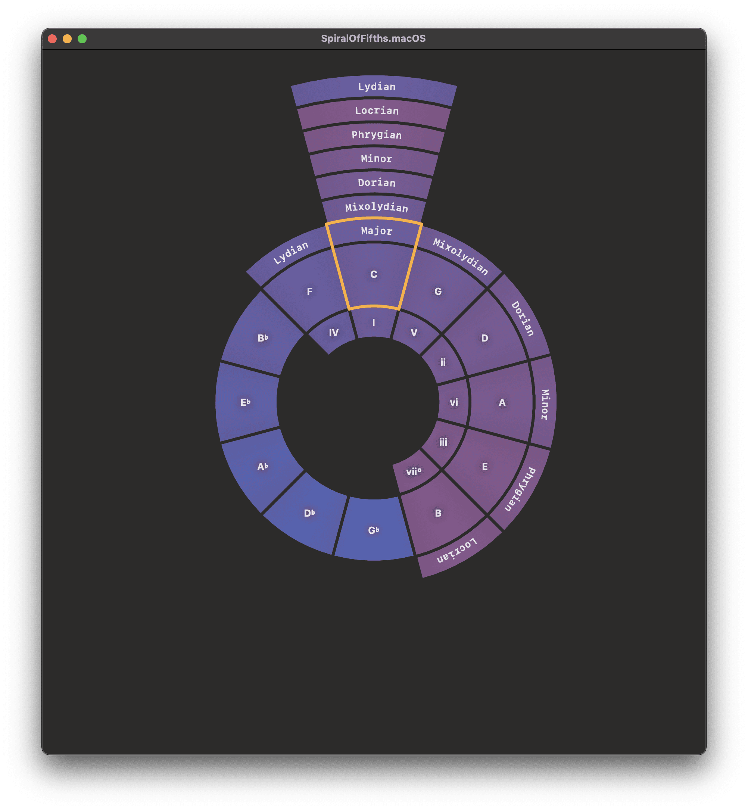
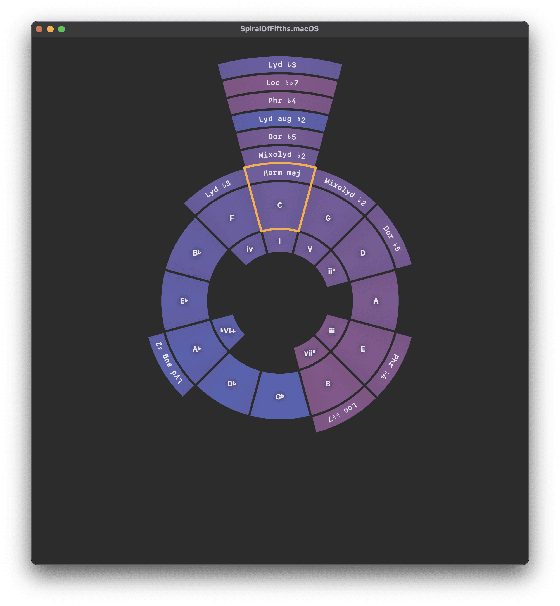
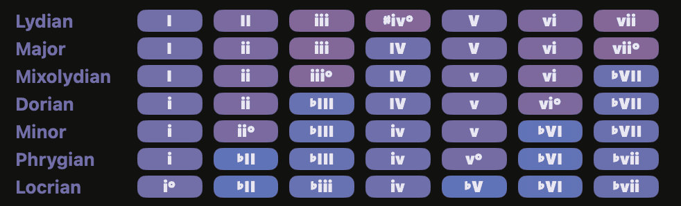

# TheoryDiagrams

[](https://github.com/progressive-guys/TheoryDiagrams/actions/workflows/package-contract.yml)


A SwiftUI library for interactive music theory diagrams, including the Spiral of Fifths visualization, chord tables, mode formula diagrams, and scale degree diagrams.

## Features

- **SpiralOfFifthsView**: Interactive circular/spiral visualization of the circle of fifths with support for different scales and modes


|           Diatonic           |           Harmonic major           |
| :--------------------------: | :--------------------------------: |
|  |  |

- **ModesTableView**: Table view showing chord relationships and modes


## Requirements

- iOS 16.0+
- macOS 13.0+
- visionOS 1.0+
- Swift 6.0+

## Installation

### Swift Package Manager

Add to your `Package.swift`:

```swift
dependencies: [
  .package(url: "https://github.com/modality-lab/TheoryDiagrams.git", from: "1.0.0"),
]
```

Then add to your target:

```swift
.target(
  name: "YourTarget",
  dependencies: [
    .product(name: "TheoryDiagrams", package: "TheoryDiagrams"),
  ]
)
```

## Tuist

Use Xcode with Swift 6.4 or later and mise. From a standalone checkout:

```sh
mise install
mise exec -- tuist install
mise exec -- tuist generate --no-open
```

`Project.swift` declares the native library and test targets. Keep its sources, resources and dependencies consistent with `Package.swift`. The `ModalityBuild` plugin comes from `ModalityCore/SwiftStyle` and runs the shared checks before compilation. All consumers select the same fixed Git commit of the plugin.

Package products are the default dependencies. A consumer can set `TUIST_LOCAL_PROJECTS_ROOT` to select its directory of local projects. Standalone checkouts leave this option unset. SwiftPM remains available through `Package.swift`.

## Usage

```swift
import TheoryDiagrams
import SwiftUI

struct ContentView: View {
  @State private var spiralOfFifths = SpiralOfFifths.cMajor
  
  var body: some View {
    SpiralOfFifthsView(spiralOfFifths: spiralOfFifths)
  }
}
```

## Example App

The `Example/` folder contains a full demo application showcasing all diagram components with:

- Interactive spiral of fifths with note selection
- Onboarding flow explaining music theory concepts
- Settings for customizing the visualization
- Support for iOS, macOS, and visionOS

### Running the Example

Use the commands in [[README#Tuist]]. Select your target platform and run the `SpiralOfFifthsDemo` scheme.

## Dependencies

- [SwiftMusicTheory](https://github.com/modality-lab/SwiftMusicTheory) - Music theory primitives
- [ModalityCore](https://github.com/modality-lab/ModalityCore) - Core utilities and design components
- [MarkdownUI](https://github.com/gonzalezreal/swift-markdown-ui) - Demo content only
